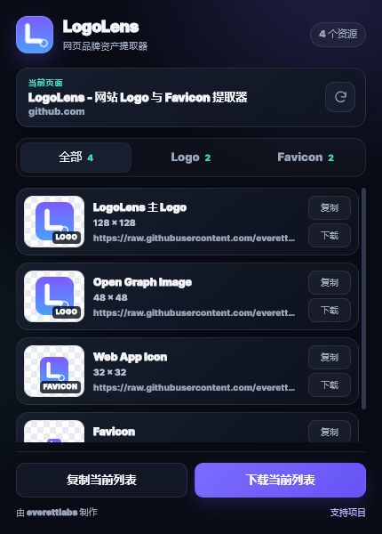
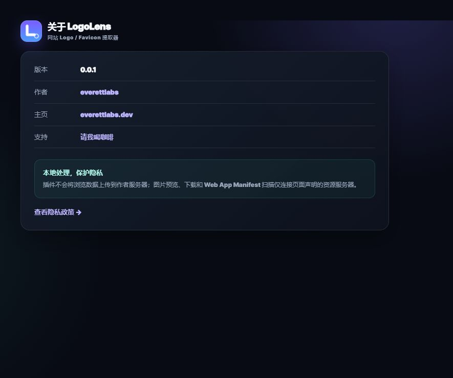
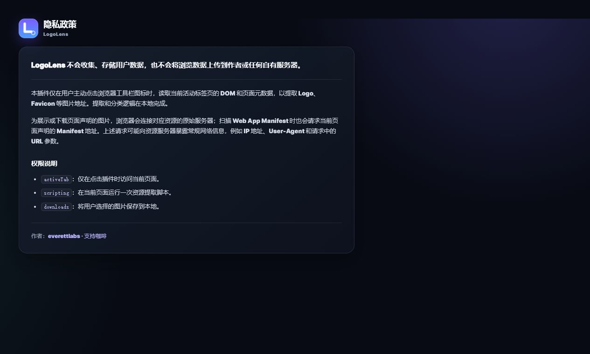

# LogoLens

> 一键发现、预览并下载网页中的 Logo、Favicon 与应用图标。

[](https://github.com/everett7623/LogoLens/releases/latest)
[](https://developer.chrome.com/docs/extensions/develop/migrate/what-is-mv3)
[](LICENSE)

LogoLens 是一个零依赖的 Chrome Manifest V3 扩展。它只在你点击扩展图标时扫描当前网页，在本地整理可用的品牌图片资源，无需账号、后端服务或额外配置。



## 功能亮点

- 自动发现常见 Logo 图片、内嵌 SVG、Schema.org 图片及社交分享图。
- 提取 Favicon、Apple Touch Icon、Mask Icon 和 Web App Manifest 图标。
- 按“全部 / Logo / Favicon”筛选结果，并展示格式、尺寸与资源地址。
- 支持打开原图、复制单个链接、复制当前列表、单项下载和批量下载。
- 支持重新扫描，方便检查动态加载或更新后的页面资源。
- 扫描与分类逻辑在本地执行，不上传浏览记录或提取结果。

## 快速安装

### 从 Release 安装

1. 打开 [Releases](https://github.com/everett7623/LogoLens/releases/latest)，下载 `LogoLens-v0.0.1.zip`。
2. 解压 ZIP 文件。
3. 在 Chrome 地址栏打开 `chrome://extensions/`。
4. 开启右上角的“开发者模式”。
5. 点击“加载已解压的扩展程序”，选择解压后的目录。
6. 建议将 LogoLens 固定到浏览器工具栏。

### 从源码安装

```bash
git clone https://github.com/everett7623/LogoLens.git
```

然后在 `chrome://extensions/` 中加载仓库根目录。

> Chrome 不允许未上架的扩展直接从 ZIP 运行，必须先解压并通过“加载已解压的扩展程序”安装。

## 使用方法

1. 打开任意普通的 `http://` 或 `https://` 网站。
2. 点击工具栏中的 LogoLens 图标，等待扫描完成。
3. 使用顶部页签筛选 Logo 或 Favicon。
4. 点击“复制”获取资源链接，或点击“下载”保存图片。
5. 使用底部按钮复制或下载当前筛选结果；页面发生变化后可点击重新扫描。

更完整的安装、操作、下载规则和故障排查说明，请查看 [使用指南](docs/USAGE.md)。

## 识别范围

| 类别 | 识别来源 |
| --- | --- |
| Logo | 图片的 `alt`、`class`、`id`，页头与导航区域，主页链接内图片 |
| 内嵌图形 | 页头、导航及 Logo 相关节点中的可见 SVG |
| 结构化数据 | Schema.org / JSON-LD 中的 `logo` 与 `image` |
| 社交图片 | Open Graph 与 Twitter Card 图片 |
| 网站图标 | Favicon、Apple Touch Icon、Mask Icon、Fluid Icon |
| 应用图标 | Web App Manifest 的 `icons` 声明 |

LogoLens 会对地址进行规范化和去重，优先展示 Logo 与较大尺寸资源，并将单次扫描结果限制在合理数量内。

## 项目截图

| 扫描结果 | 关于页面 |
| --- | --- |
|  |  |

隐私政策页面预览：



## 权限与隐私

| 权限 | 用途 |
| --- | --- |
| `activeTab` | 仅在用户点击扩展时访问当前活动网页 |
| `scripting` | 向当前页面注入一次资源扫描函数 |
| `downloads` | 保存用户主动选择的图片资源 |

扩展没有后台服务、账号系统、分析 SDK 或远程 API，也不会持久化扫描结果。图片预览、下载以及 Web App Manifest 扫描会连接网页声明的原始资源服务器。详细说明见 [隐私政策](PRIVACY.md)。

## 使用限制

- Chrome 内部页面、Chrome Web Store 等受保护页面不允许扩展注入脚本。
- 页面未使用可识别的语义、属性或结构时，部分 Logo 可能无法自动发现。
- 远程服务器的防盗链、鉴权或跨域限制可能导致预览或下载失败。
- 动态加载资源出现较晚时，可等待页面稳定后点击重新扫描。

## 项目结构

```text
LogoLens/
├── manifest.json        # Chrome 扩展配置与权限
├── popup.html           # 弹窗结构
├── popup.css            # 弹窗、关于页和隐私页共享样式
├── popup.js             # 扫描流程、筛选、复制与下载逻辑
├── extractor.js         # 注入页面的资源发现函数
├── options.html         # 关于页面
├── privacy.html         # 扩展内隐私政策页面
├── icons/               # 扩展图标
├── docs/                # 使用指南与项目截图
├── CHANGELOG.md         # 版本更新记录
└── PRIVACY.md           # 仓库隐私政策
```

## 本地开发

项目没有构建步骤、运行时依赖或包管理器。修改源文件后：

1. 在 `chrome://extensions/` 的 LogoLens 卡片上点击“重新加载”。
2. 重新打开扩展弹窗。
3. 在普通网站上手动验证扫描、筛选、复制、下载和重新扫描。

基础校验：

```powershell
python -m json.tool manifest.json > $null
node --check extractor.js
node --check popup.js
```

## 版本与更新

当前版本：`0.0.1`

- [更新日志](CHANGELOG.md)
- [所有 Releases](https://github.com/everett7623/LogoLens/releases)

版本发布时，`manifest.json` 与 `options.html` 中显示的版本号必须保持一致。

## 参与贡献

欢迎通过 [Issues](https://github.com/everett7623/LogoLens/issues) 报告无法识别的网站、下载问题或界面建议。提交代码前，请确保权限保持最小化，并手动检查弹窗、关于页面与隐私页面。

## License

本项目基于 [MIT License](LICENSE) 开源。

作者：[everettlabs](https://everettlabs.dev/) · [支持项目](https://everettlabs.dev/coffee/)
